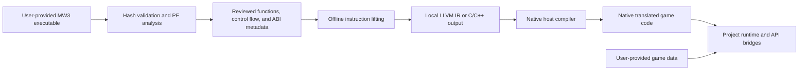

# MW34 RECOMP architecture

Status: initial design, 2026-10-06. MechWarrior 3 is the only implementation target.
The bootstrap runtime is a foundation for experiments; it is not a functioning
game runtime. The pipeline below is planned unless an implementation and a passing
experiment are explicitly identified in the repository.

Current strategy update, 2026-10-11: [faithful modernization](faithful-modernization-plan.md)
preserves recompiled game logic and implements modern services behind observed
guest contracts. The initial-design descriptions below retain their historical
scope; they do not imply that later runtime/registry components are absent.
The [milestone register](project-milestones.md) and [Claude work review](m4-claude-work-review-2026-10-11.md)
describe current evidence. No whole native game or live renderer is available yet.

## Integration decision and service boundary

Use the existing guest memory, state, dispatch and compiled components as the
foundation of one native host. Separate game algorithms from window/files,
allocation/synchronization, audio/input and Vulkan services. Preserve ABI,
ownership, failure, callback and guest-visible state at the service boundary.
Translate CRT/MFC internals where these semantics require it; do not require
instruction-for-instruction reproduction of every legacy host service by default.

The first execution-path audit must choose retail translated entry or a justified
host bootstrap into the recovered application. Bootstrap equivalence requires
all required initializers, provider/TLS/FS/SEH state and shutdown/cleanup order;
no missing side effect may be concealed by a successful return. Modernization
changes implementation choices, not the accepted 144-root criteria or game rules.
No original-code fallback or interpreter is authorized in the production host.

Bind Vulkan to live rendering operations from translated game producers. Saved
capture replay and original-process graphics transport remain explicitly separate
diagnostics. Implement modern controls at the input contract and retain original
simulation cadence before adding optional rendering interpolation.

## Pipeline and ownership

The runtime executes compiled host code. It has no x86 instruction interpreter or
runtime translation fallback. Unresolved code stops with an address and reason.
Maintaining explicit guest registers for correctness does not require interpreting
instructions at runtime. See the [research decision](recompilation-research.md)
for candidate tools and the first experiment.

| Area | Responsibility |
| --- | --- |
| `tools/binary-validator` and `tools/analysis` | Read-only identity checks, bounded PE parsing, dependency reports, and analysis entry points. |
| `games/mw3/config`, `symbols`, `patches`, `docs` | Version-specific metadata, evidence, known layouts, function aliases, and replacement selection. |
| `recomp/translator` | Future adapter from reviewed analysis to the selected lifter and native-compilable output. |
| `recomp/generated` | Local output only; no proprietary input, lifted game IR, or game-derived compiled objects in source control. |
| `runtime/core`, `memory` | Guest state, checked memory, dispatch, and diagnostic failures. |
| `runtime/win32`, `graphics`, `input`, `audio` | Project-authored bridges implementing only observed game requirements. |

User files, full disassembly, strings, lifted code, and detailed analysis databases
stay local. Committed evidence should use hashes, addresses, structural metadata,
and independently authored explanations. Public build/test fixtures are authored
for this project. See [distribution policy](legal.md).

## Guest memory contract

Guest pointers and addresses are **32-bit unsigned values**, including pointers
inside structures, vtables, stacks, import slots, and saved state. Host pointers
must never be stored in these fields. A pointer-bearing guest structure is a
documented byte layout, not a native C++ struct containing `void*`.

The initial implementation uses checked memory access over mapped guest ranges.
An access is `memory.load<std::uint32_t>(guest_address)`, never a cast from the
guest integer to a host pointer. Arithmetic on guest registers follows x86 widths;
effective-address calculation may wrap modulo 2^32, but a memory range operation
must reject a span crossing the end of the guest address space. Validate ranges
with widened arithmetic before any host allocation or access. Multi-byte values
use little-endian encoding and permit guest unaligned addresses without unaligned
host loads or strict-aliasing violations.

Planned regions include the original image, a guest heap, per-thread stacks, and
guest representations of runtime objects. The bootstrap `GuestMemory` owns
zero-initialized byte vectors for non-overlapping mappings and supports map,
unmap, protect, checked reads/writes, and unsigned little-endian loads/stores
through 64 bits. An access must fit one mapping, even when another mapping is
adjacent. Read/write permissions are enforced; execute permission is metadata
only. `GuestAddress` is four bytes and offers explicit wrapping addition. This
is not yet a PE loader, page-based virtual-memory manager, allocator, or complete
Windows process. Add guard regions, allocation rules, and concurrency semantics
only when the next experiment needs them.

Preserve preferred guest image addresses initially. A future loader must map
section virtual sizes, copy file-backed bytes, zero required tails, and account
for relocation records. Fixed guest addresses do not require allocating host
memory at those addresses. Use `(binary SHA-256, RVA)` as the stable analysis key;
compute guest VAs from the chosen guest image base. Missing relocations, TLS,
delay imports, forwarded exports, packed images, and overlays are explicit
analysis concerns, not reasons to guess loader behavior. The
[Microsoft PE specification](https://learn.microsoft.com/en-us/windows/win32/debug/pe-format)
defines the file structures.

A later 4 GiB virtual reservation could accelerate access, but is a measured
optimization rather than an initial requirement. Keep address checks and access
semantics stable so an arena or sparse mapping can be substituted. Saving native
heap addresses or making the guest depend on host allocation order is forbidden.

## State, arithmetic, and floating point

The translation contract preserves registers, subregister writes, EIP/ESP,
relevant EFLAGS, and guest memory. Do not express x86 overflow as signed C++
overflow, assume a host shift matches all x86 count rules, or attach LLVM
`nsw`/`nuw` promises without proof. Defined live flags are observable state;
undefined flags need an explicit policy and must not be treated as reliable
reference outputs.

Floating point is a separate admission gate. Model the x87 stack and tags,
control/status words, precision and rounding settings, and exception behavior.
Native `double` is not an automatic substitute for x87 extended intermediates;
host `long double` is not portable across MSVC, Clang targets, and ARM64. Start
without fast-math or contraction assumptions. Validate spill/reload behavior,
integer conversion, NaNs, signed zero, and denormals against the original before
choosing an implementation. MMX aliases x87 state; SSE/MXCSR need their own
coverage if observed. The presence of these instruction families in MW3 remains
an analysis question until a validated image is inspected.

## Calling conventions and control flow

Generated functions should initially use one internal host signature receiving
guest context and memory. The exact ABI is selected with the lifter experiment;
it is not the recovered original function prototype. Each bridge implements the
original x86 contract: stack argument placement, register arguments, return
registers, preserved registers, and caller/callee stack cleanup. `cdecl`,
`stdcall`, `thiscall`, and variadic calls cannot be freely interchanged.
[Microsoft's x86 calling-convention documentation](https://learn.microsoft.com/en-us/cpp/cpp/argument-passing-and-naming-conventions?view=msvc-170)
is a reference; the actual binary remains the evidence for each call site.

Function pointers remain guest code addresses. A registry resolves an admitted
address to a generated implementation or a selected replacement. Never cast an
integer from guest data into a host function pointer. Direct calls to replaceable
functions, indirect calls, and guest callbacks must all use the same routing
decision. A proven unpatchable internal direct edge may later be optimized.

Jump tables need reviewed bounds, entry encoding, and destinations. Tail calls,
shared blocks, mid-function targets, and computed returns cannot be assumed to
follow C++ call structure. Start with ordinary leaf functions; introduce explicit
continuations or block dispatch only when observed control flow requires them.
Every unresolved target reports the guest PC and target and fails visibly.

Host callbacks require typed host thunks that populate a guest call frame, restore
the correct guest thread context, route the guest address, and marshal the return.
Handle reentrancy explicitly. COM objects require 32-bit guest object/vtable
layouts and a host object table; native COM pointers do not fit in guest storage.

## APIs, exceptions, and concurrency

API bridges copy and validate pointer-bearing arguments, convert guest handles
through handle tables, and preserve return values, output buffers, last-error
behavior, and lifetime rules. Begin with APIs on the selected function's actual
path. Classify imports from kernel32, user32, advapi32, winmm, shell, CRT, and
network libraries; discover dynamic resolution and ordinal imports separately.
Do not claim that an import list is a complete API inventory.

SEH, C++ exceptions, RTTI, TLS, FS-relative access, and nonlocal jumps require
dedicated analysis. Guest exception registration and stack unwinding do not
automatically become host C++ exceptions. The first execution slice excludes
these features; encountering one is an explicit failure until implemented.
Later work must describe dispatch, cleanup, and unwinding behavior before
translating exception-bearing functions.

Use a distinct guest context and stack per guest thread. Host threads may back
them later, but thread-local last error, callbacks, locks, memory ordering, and
wait behavior must be accounted for. Converting unsynchronized guest accesses
into ordinary racing C++ accesses can introduce host undefined behavior. The
bootstrap memory objects are not a concurrent process model.

## Graphics, input, audio, and time

Updated direction, 2026-10-08: the user selected **Vulkan** as the renderer target
for modern capabilities and portability. The assessments below preserve the
earlier alternatives, but no longer represent an open backend selection.
See [the Vulkan learning prototype](vulkan-learning-prototype.md) for the first
executed GPU experiment, scope limits and graphics recovery gates. No integrated
game renderer exists yet; ray tracing remains an optional capability tier.

Preserve the game-facing legacy interfaces separately from backend code. The
first graphics milestone is correct state and pixels. Establish actual interface
versions from imports, GUIDs, and observed calls before declaring D3D6 coverage.
Record surface formats, pitch, lock/unlock, palettes, color keys, clipping,
depth/blend/fog state, texture updates, and COM lifetime behavior as encountered.

| Backend | Initial assessment |
| --- | --- |
| Direct3D 11 | Earlier simplest-Windows experiment candidate; superseded by the user's Vulkan direction. It still requires implementing legacy state and fixed-function behavior in the bridge. |
| Direct3D 12 | More explicit synchronization and resource management increase the first experiment's scope. Defer unless a measured requirement favors it. |
| Vulkan | Selected target for Windows/Linux portability and modern capabilities; explicit barriers, resource lifetime, and synchronization require implementation and validation. Recover graphics behavior before integrating. |
| SDL GPU | Cross-platform abstraction with Vulkan, D3D12, and Metal backends. Promising portability option, but legacy formats, surface locking, and render-state behavior still need project code and testing. |

These assessments are based on the documented API responsibilities:
[D3D11/D3D12 differences](https://learn.microsoft.com/en-us/windows/win32/direct3d12/important-changes-from-directx-11-to-directx-12),
[Vulkan synchronization](https://docs.vulkan.org/guide/latest/synchronization.html),
and [SDL GPU](https://wiki.libsdl.org/SDL3/CategoryGPU). Vulkan is selected, but
no integrated graphics backend is implemented yet.

Texture quality is a staged M7 renderer feature, not a property of Vulkan alone.
First recover the current sampler/material contract (mip availability, min/mag
filters, LOD, address modes, color space and alpha/color-key handling). Then
generate or load filtered mip chains and expose trilinear filtering and
device-limited anisotropic filtering. Mip levels reduce minification aliasing;
anisotropy improves samples on oblique surfaces. Preserve a legacy-compatible
profile and compare both profiles at representative distances and during camera
motion. See the Vulkan sampler and [mipmap/LOD guidance](https://docs.vulkan.org/tutorial/latest/Building_a_Simple_Engine/Advanced_Topics/Mipmaps_and_LOD.html)
for backend-neutral sampling concepts.

Treat anti-aliasing and upscaling as separate, later settings. FXAA is a possible
post-process for jagged geometry edges; measure its effect on texture detail,
HUD and text sharpness, and do not treat it as a replacement for mipmapping.
Keep internal render size distinct from output size. Evaluate a spatial upscaler
such as FSR 1 only after a correctly resolved, anti-aliased frame exists. Temporal
upscaling requires additional validated inputs such as motion vectors and depth;
it does not directly repair texture shimmer. These are M7 candidates, not backend
or library selections. The [M7 milestone workstream](project-milestones.md#m7-graphics-and-texture-rendering-workstream)
defines the gates and acceptance evidence.

Input bridges should deliver the original expected state, event ordering, and
device acquisition behavior. Controller, HOTAS, pedal, and force-feedback
improvements follow correctness. Audio work starts with observed DirectSound
buffer, format, cursor, loop, and notification semantics; backend selection waits
for those requirements.

Preserve original timer values and update order first. Record simulation entry
points, delta-time units, wraparound, clamping, busy waits, sleep behavior, and
render/simulation coupling. A fixed simulation timestep with interpolated
rendering is a future configurable replacement, not a bootstrap assumption.

## Explicit replacements

Each future replacement declaration binds an exact binary hash, function RVA,
calling contract, replacement identifier, configuration gate, evidence, and tests.
Enable only for the validated build. Verify optional instruction signatures
locally; never use a fuzzy signature as a substitute for binary admission.

Default routing selects the generated implementation. A replacement can call the
explicitly named original route without recursively selecting itself. Reject
duplicate/conflicting registrations. Build the selection table before execution;
hot patching and concurrent mutation are out of scope. Log which replacements
are active so original behavior remains reproducible.

## Validation boundary

The original bootstrap tests establish guest-memory bounds, permissions and
integer layout using authored fixtures. Later M1-M3 and finite M4 components
have their own acceptance records; do not treat the initial bootstrap description
as a current absence-of-registry claim. Those finite results do not establish
whole-game compatibility. New execution slices compare compiled behavior and
observed original boundaries with explicit dependency, ABI, resource and failure
scope. ARM64 remains a later portability test, not a claimed target.
