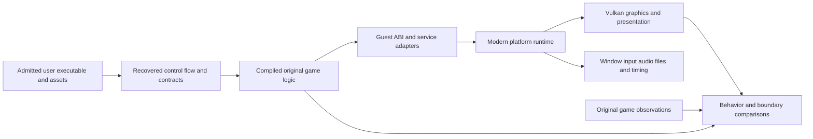

# Faithful recompilation with modern platform services

Decision: 2026-10-11, authorized by the user. MechWarrior 3 U.S. retail 1.2 is
the current game; Windows x64 and Vulkan are the first host/backend targets.
This is the current implementation strategy. It supersedes older priority
queues, not accepted evidence, frozen contracts or milestone completion rules.

Owner clarification, 2026-10-24: the no-pack baseline must retain stock game
content and presentation, with an independent optional Dynamic Lighting switch
and authorable community replacement/addition packs. See the
[stock baseline and community packs plan](stock-baseline-and-community-packs-plan.md)
for required separation, current gaps and implementation order.

## Product and fidelity

Preserve the original game logic through native recompilation. Supply modern
platform services behind recovered game-facing interfaces. Do not restart as
an independently invented gameplay remake or replace physics/AI with approximate
new rules. Reuse the image loader, CPU/ABI work, translated components, service
contracts, application maps and graphics investigations already available.

Original-compatible mode preserves mission logic, AI, physics, damage, weapons,
animation decisions, randomness, simulation cadence, asset interpretation and
save semantics where supported. Preserve behaviorally significant quirks by
default. An intentional gameplay fix needs a named option, baseline, explanation
and regression checks. Legacy register/ABI/FP behavior remains strict where
translated code or callbacks observe it; modernization does not authorize
AFTER-state seeding, invented API success or hidden omissions.

The runtime can modernize window management, graphics, input, audio, files,
allocation and synchronization. Implement each observed contract, including
failure, ownership, cleanup, threading and callback behavior. Do not reproduce
every instruction in an old CRT/MFC implementation as a prerequisite by default.
Keep its translated implementation where guest-visible internal state, layout
or control flow requires it. Classify these cases before selecting replacements.

Vulkan is the selected graphics backend, not an open research choice. Begin with
original-compatible geometry, cameras, textures, alpha/color-key behavior,
depth, lighting, fog and HUD. Add modern window/resolution handling, remapping
and device support through that runtime. Enhanced filtering, widescreen/FOV,
interpolation, new assets and effects are independently configurable after
their affected behavior has a measured baseline. No need to postpone all modern
platform engineering until the whole campaign passes; no enhancement may conceal
a baseline defect. Keep original simulation timing first; do not raise the game
tick merely to obtain a higher rendering FPS.

## Architecture

Guest addresses remain 32-bit; host pointers, COM objects and Vulkan handles stay
in host-owned registries. Use the existing explicit guest-state/dispatch contracts.
No interpreter or original-binary execution fallback is authorized for the final
native executable. Original-game runs, capture replay and existing cross-process
replacement experiments remain reference/diagnostic tools with explicit labels.
A hybrid approach may be investigated if it resolves a concrete integration
problem, but it is not the production strategy or automatic accepted recompilation.
Original 32-bit code cannot simply be loaded as a DLL in an x64 process.

The first architectural decision is the startup boundary: retail translated
entry versus an explicit host bootstrap into a recovered application entry.
Choose from actual source/call/state evidence. A host bootstrap must account for
every required initializer side effect, TLS/FS/SEH state, provider object,
registry, destructor and callback order. It must never skip initialization just
because a function is hard to translate. Record every omitted retail operation
and its equivalent runtime contract, or reject that route.

## Execution milestones alongside M1-M8

These checkpoints organize work; they do not rename or complete M4/M5. Every
checkpoint records executable identity, actual producers, observed outcome and
the next unsupported boundary. A fixture may be useful without satisfying a
game checkpoint.

| Checkpoint | Deliverable and required evidence | Present status |
| --- | --- | --- |
| E0: execution path audit | Source-bound map from host/guest entry through initialization, application callbacks, menu, message loop, asset loading and Training render/update. Distinguish static candidates from executed routes. Classify dependencies and select one first implementation blocker. | First map recorded in [E0 path audit](e0-application-execution-path.md): retail translated entry chosen; native execution now reaches the CRT `malloc` CALL after the connected parser; next blocker is CRT heap/provider attach state. |
| E1: integrated native host | Existing guest runtime and required window/backend services in one project-built x64 executable. Execute a justified translated application boundary; stop with exact PC/service/state if incomplete. Authored surface upload alone is backend readiness. | Open; separate runtime and replay viewer are not this host. |
| E2: live native menu | Required initialization, archive/widget receivers and live rendering from translated producers; real input changes menu state and normal shutdown releases resources. A displayed bitmap or recorded scene does not qualify. | Open; contributes to M4 when all required M4 criteria close. |
| E3: live native Training frame | Load Training assets and execute the game update/render path into Vulkan. Frame evidence identifies translated producers and original-comparable scene state. | Open; no replay substitution. |
| E4: playable faithful Training | Movement, weapons, collision, AI, HUD, input/audio, quit and controlled original/native comparisons under original-compatible settings. | Open; contributes to M5. |
| E5: compatibility expansion | Representative campaign/Instant Action, save/load, timing, error paths and extended play; reproducible asset-free build/install. | Open; M6 criteria remain. |
| E6: validated modern features | Independent settings and original-mode regression for each feature; performance/device limits and fallbacks measured. | Some isolated prototypes exist; integrated feature acceptance is open. |

## Immediate queue

1. Read the [Claude work review](m4-claude-work-review-2026-10-11.md). Leave
   composer PID44416 and its watcher intact. Inspect current status rather than
   trusting this dated snapshot. Do not open its active SQLite database.
2. Perform E0 using `tools/m4-startup/`, `tools/m4-runtime/`,
   `runtime/mfc/app_receiver_state.*`, `runtime/graphics/direct_draw_creation.*`
   and [application workahead](m4-application-workahead.md). Reuse the receiver,
   reader, video/COM and presenter contracts; inspect actual current files.
   Document PC/call, required input state, source provenance, translated-code
   availability, service owner, first missing dependency and a narrow test.
3. Compare retail entry and explicit bootstrap routes. Classify dependencies as
   translated gameplay, observable legacy service, replaceable host service or
   unresolved. Do not infer game semantics from API names. Evaluate reusable
   translation/runtime components only for the identified gap; no framework
   replacement, installation or repository restart on assumption.
4. Implement the smallest dependency that advances E1/E2. Prefer integration of
   existing components over another standalone harness. If execution stops,
   capture one useful boundary and fix it; avoid arbitrary success stubs.
5. Progress live Vulkan integration through the recovered surface/command path.
   Coordinate with [current graphics work](live-native-rendering-current-work.md)
   and reuse [video contracts](m4-video-backend-contract-r1.md),
   [presenter review](m4-vulkan-presenter-extraction-review-r1.md) and
   [viewer audit](m4-vulkan-viewer-reproducibility-audit-r1.md). Other writers
   own current graphics edits; do not overlap without coordinating.

The retained application map is static evidence, not a launch claim. It describes
candidate run `58FD70`, queued startup object `608F58`, factory/state transitions
and `486990 -> 486260` loading `dialog.zrd/MAINMENU`, plus renderer/input receiver
`486D40 -> 48ED30`. Revalidate those candidates against current source contracts;
do not assume constructor return means successful asset loading.

## Existing acceptance work remains valid and separate

Accepted selected startup roots remain **131/144**, with 13 remaining. The
authoritative acceptance receipt (not included in this public documentation snapshot)
has SHA256 `aa9462f30bf4fa6c80ef926488928bb8680f207020e4f0aa166968caaf724061`.
This fraction is not total M4 or project completion. No new accepted function,
native menu, Training or renderer claim is created by this plan.

The legacy controls chain continues: composer, admission **v2**, independent
composite reviewer, actual 45-field review, candidate finalization, configuration,
exact allowance review and strict acceptance. Preserve all 39 required gates,
841 typed predicates, source/resource/semantic limits and fresh whole-input
conservation. The active composer and any approved full review may be expensive;
do not duplicate them. This task authorizes planning and documentation, not
starting those long jobs. When continuing, Claude should finish the authorized
chain in a separate lane while doing independent execution work.

Current141 probe evidence is reusable, but inventory completeness, CRT/ENV policy
review/admission, 53 inherited-check rebinding, full paired141 comparer and final
acceptance remain open. HYPOT, version and loader also remain connected blockers.
These tasks enter the execution lane when a recovered application boundary
actually requires them, and stay on the acceptance backlog otherwise. Do not
discard required initializer behavior or relabel probes as accepted progress.

## Validation and work discipline

For each change, state the observed contract, expected executable advance and
smallest useful check before implementation. Use directed ABI/resource tests
and original/native comparisons for changed behavior; recheck callers affected
by the change. Reuse current receipts and admitted immutable inputs when their
scope still applies. Full inventories and milestone acceptance still use their
existing strict criteria; ordinary development checks need not rerun them all.

Build controlled scenarios for positions, velocities, damage, AI decisions,
random-call order, mission events, save/load and timing. Rendering comparisons
need matched camera/state/resolution, command order, textures, depth and HUD.
Define numeric tolerances from a measured contract, never to excuse a mismatch.
Record requested modern settings separately from original-compatible settings.

No new verifier/report layer without identifying an uncovered criterion or a
concrete execution defect. Preserve failures in fresh namespaces, avoid giant
eager JSON loads and serialize heavy readers. Documentation-only changes use
diff/link/consistency checks, not game captures or hours-long verifier runs.
Report actual execution boundary, changed code, validation, fidelity limits,
accepted count and next blocker. Keep reports bounded and useful to the next
developer. Original media, traces and generated game code remain local.

## Documentation authority

This plan controls current strategy; [roadmap](roadmap.md) and
[milestones](project-milestones.md) summarize it. [Architecture](architecture.md)
retains guest ABI/FP/runtime contracts. [Plan r14](m4-execution-plan-r14.md) is
the detailed acceptance/probe history, not the sole implementation queue.
Older revisions, audits and frozen receipts retain their dated scopes. Change
documentation priorities without modifying evidence hashes or erasing failures.
