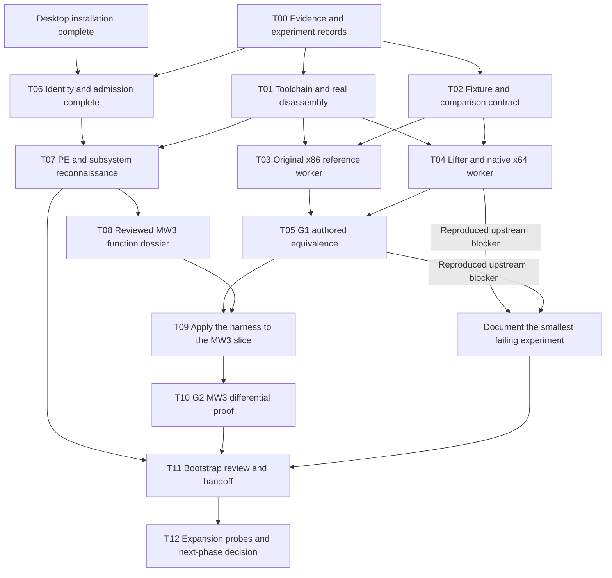

# MW3 initial-phase execution plan

Plan started: 2026-10-06. Completion review: 2026-10-07. Scope: MW3 Bootstrap
and the first bounded native execution proof. G2 now passes for one reviewed
integer leaf; the whole-game runtime and expansion probes remain pending.
The [roadmap](roadmap.md) is the summary; this document owns the detailed sequence
and acceptance criteria. [Architecture](architecture.md) and
[research](recompilation-research.md) explain the underlying design decisions.

## 1. The result we are working toward

The preferred result is one real, version-identified MW3 function translated
offline, compiled into native x64 code, and tested against the original x86
function on identical inputs. Alongside it, we need a reproducible analysis
workspace and an evidence-backed map of the game's major technical dependencies.

There are three distinct checkpoints:

| Checkpoint | What it establishes |
| --- | --- |
| R: reconnaissance ready | One admitted game executable, reviewed PE/API reports, working disassembly, and a tracked research backlog. |
| G1: authored translation proven | Our own x86 fixtures execute equivalently in original x86 and translated native x64 forms. No MW3 claim yet. |
| G2: first MW3 function proven | A reviewed function from the admitted game executable passes the same comparison process. |

G2 is the initial-phase engineering target. The original Bootstrap definition
also permits a documented technical blocker in place of a running translation.
That alternative needs a reproduced failure, a minimized case, a precise cause
or unresolved question, and the next discriminating experiment. It must still
include the required admitted game identity and reconnaissance deliverables.
An unfinished installer or an unbuilt tool is an access/setup dependency, not
evidence that MW3 cannot be recompiled. A blocked result must be reported as
**Bootstrap research completed with execution blocked**, never execution proven.

Whole-game startup, menus, missions and rendering are later milestones. Our
graphics discussions, including normal mapping, remain future requirements.

## 2. Current position

| Item | Evidence available now |
| --- | --- |
| Repository and C++ foundation | Git initialized. MSVC Debug/Release builds and tests passed in the recorded bootstrap session. |
| Tests | Current Debug build and six CTest groups passed; all 23 monitor tests passed across the sandbox run and two focused outside-sandbox checks. Fourteen adapter tests and 20 comparison tests passed. Historical Debug/Release snapshots are labeled separately in the [validation record](bootstrap-validation.md). |
| Memory | Checked 32-bit guest addresses, mappings and little-endian integer access exist. The ADD experiment has a bounded CPU-state and ABI bridge; a general loader/runtime remains pending. |
| Analysis tools | Real LLVM 21.1.8 PE disassembly ran on the admitted game; headers/imports cross-checked with llvm-readobj and the selected leaf with Remill/XED. Synthetic adapter tests also pass. |
| Media | The ISO's README identifies base media as 1.00 U.S.; the supplied 1.2 patch was applied. See [media observations](media-inventory.md) for provenance and the preserved base baseline. |
| Installation | Original wizard and 1.2 patch completed at `D:\Projects\MW34Recomp\MW3`. Main menu observed with dgVoodoo2; user reports playable training and a terrain/view glitch apparently resolved by a 30 FPS limit. Broader stability remains unverified. See the [MW3 findings](../games/mw3/docs/findings.md). |
| Supported image | `mw3-us-1-2-retail` is admitted by exact hash; validator and strict metadata analyzer passed. See [supported binaries](supported-binaries.md). |
| Translation | Current G1 covers four authored leaves: 40,576 valid x86 cases, 81,152 O0/O2 native comparisons and 135 rejection/bridge checks. G2 passes the actual reviewed MW3 leaf on 16,609 cases, 33,218 native comparisons and 49 controls. See the [validation record](bootstrap-validation.md) and [suite record](fixture-suite-experiment.md). |

T06's install, exact identity and changed-code rejection check are complete.
G1 passed its authored integer-leaf contracts. The bounded reconnaissance review
(R), selected leaf's static contract, private extraction, native adaptation and
G2 differential execution are complete. The original executable remains unchanged.
The separate authored x86 replacement was called once in the original game with
zero mismatches, and the user confirmed Training loaded. That observation and
the isolated native x64 comparison are separate experiments. See the
[first-function dossier](../games/mw3/docs/first-function.md).

## 3. Scope and operating decisions

- Use MW3 only and one active executable profile for the first proof:
  `mw3-us-1-2-retail`. Keep the preserved base installation evidence separate from
  the patched identity. Admission does not establish execution compatibility.
- Run the reference worker as a 32-bit Windows process and the translated worker
  as a native 64-bit process. Keep the existing C++20/CMake foundation.
- Evaluate Remill first, with SRW/llasm as the bounded fallback/comparison. Pin
  exact working revisions; the research recommendation is not a tool adoption.
  Ghidra supplies reviewed analysis, not automatically trusted compilable source.
- Preserve guest addresses, layouts, integer/flag behavior and original timing.
  The first function will deliberately avoid APIs, exceptions and floating point.
- Give unsupported instructions, control-flow edges and imports explicit errors.
  Do not implement a permanent interpreter or silently return successful stubs.
- Build only the loader and runtime behavior the selected experiment requires.
  A general Win32 runtime, full renderer and concurrent process model are outside
  this phase. Do not expand the PE parser without a concrete observed need.
- Keep public tests and ordinary builds independent of game ownership and lifter
  installation. Game-dependent tests are explicit local opt-in tests.

## 4. Dependencies and parallel work

T00-T05 supplied the authored proof independently. T06-T08 supplied the admitted
image, bounded reconnaissance and reviewed leaf contract; T09/T10 now pass the
bounded native comparison. Whole-game reverse engineering remains later work.

## 5. Work queue

Status below is a planning snapshot. **Ready** means dependencies permit starting,
not that implementation is underway. Tool inventory and contract drafting may
overlap T00, but their acceptance records require its agreed format. Update status
and evidence links as work lands.
Priority P0 protects the first proof; P1 expands it after the proof.

| ID | Priority / current status | Deliverable | Depends on |
| --- | --- | --- | --- |
| T00 | P0 / scoped tool/input/output and source records complete | Evidence conventions, run record and reproducible source snapshot | Existing foundation |
| T01 | P0 / LLVM/Remill pins, build, authored and game disassembly passed | Pinned toolchain recipe and actual disassembly smoke test | T00 record format |
| T02 | P0 / reviewed ADD, signed-branch/partial-register, memory/stack-cleanup and shift/SUB contracts complete | Authored fixtures and explicit experiment protocol | T00 |
| T03 | P0 / four original x86 leaves passed 10,144 independent self-test cases each | Original x86 reference worker and tested capture trampoline | T01, T02 |
| T04 | P0 / four IR/layout bridges and O0/O2 native workers passed | Small lifter adapter, memory hooks and native x64 worker | T01, T02 |
| T05 | P0 / G1 complete: 40,576 valid cases, 81,152 O0/O2 comparisons, 135 controls | G1 comparison report and reproducible regression corpus | T03, T04 |
| T06 | P0 / install, identity, provenance and changed-code rejection complete | One admitted installed game executable and version provenance | Installation complete |
| T07 | P0 / bounded reconnaissance R complete; deeper recovery queued | PE/memory map, all 474 ordinary imports and research ledger | T01, T06 |
| T08 | P0 / sub_00409ED0 static contract reviewed with LLVM and XED | Complete contract for one small MW3 integer leaf | T07 |
| T09 | P0 / complete for the admitted 22-byte integer leaf | Hash-bound slice loading, checked flag/layout adaptation and generated native MW3 function artifact | T05, T08 |
| T10 | P0 / complete: 16,609 cases, 33,218 O0/O2 comparisons, zero mismatches, 49 controls | G2 differential results from actual MW3 machine code | T09 |
| T11 | P0 / complete within the bounded initial-phase scope | Auditable Bootstrap completion review with explicit remaining limits | R plus G1/G2 results |
| T12 | P1 / later | x87, calls/imports and replacement experiments; next-phase scope | T11; G2 before expansion |

### T00-T01: make experiments reproducible

Use `observed`, `inferred`, `hypothesis`, and `unknown` consistently. Each finding
must identify input SHA-256, address kind (file offset/RVA/VA), tool/version,
method, evidence location, interpretation and remaining questions.

Define a run record around deterministic reports rather than embedding volatile
machine details into PE metadata. Include source revision or authored-tree digest,
input/report hashes, exact commands/options, compiler/lifter versions, target
triples, optimization flags, corpus seed and outcome. Current analyzer JSON has
no implementation revision; this surrounding record supplies that missing link.
Use a source-tree digest while the repository is uncommitted; never label it with
a nonexistent commit. Public notes reference local evidence IDs, not private paths.

Inventory the x86 and x64 compiler/assembler, LLVM tools, lifter prerequisites,
Ghidra and the selected debugger. Install only what the next experiment needs.
Keep heavy lifting dependencies opt-in and isolated from ordinary CMake builds.
Choose a documented build host for the lifter; a Linux/WSL tool build is an option
if Windows integration proves impractical, not a requirement to change the user's
machine now. Record how its output reaches the Windows native harness.

Acceptance: real `llvm-objdump` decodes an authored PE32 fixture at expected
addresses, section filtering works, missing tools fail clearly, and the exact
tool setup can be reproduced. A successful mock invocation does not satisfy this.
Record the currently supported MSVC build and separately verify Clang/Linux core
builds when available; unrun remote CI remains unverified. Choose one formatting
tool version before treating formatting differences as source defects.

### T02-T05: prove the mechanism on authored x86

Create tiny assembly fixtures with known symbol boundaries for integer arithmetic,
conditional branches, carry/overflow, partial-register writes, unaligned memory,
and caller/callee stack cleanup. Add a direct-call fixture only after leaves work.
Keep fixtures independent of compiler optimization and use their authored symbol
metadata to establish exact code ranges. They are public project code.

Define a versioned experiment request/result format with:

- Guest registers, entry address, initialized flag bits and expected stack bounds.
- Explicit initialized memory regions, permissions, permitted writes and guards.
- Approved instruction/control-flow ranges and a defined return sentinel.
- Observable register/flag masks and termination status: returned, unsupported,
  fault, timeout, or harness failure. A crash never counts as a matching result.

Build two separate workers. The reference worker actually executes original x86
machine instructions. The translated worker executes the compiled native lift.
A handwritten C++ equivalent can help diagnose a failure but cannot serve as the
only reference for proving instruction semantics.

The reference entry/exit assembly must initialize and capture the declared state
without clobbering flags or registers before observation, account for stack cleanup,
and preserve the helper's own state, including its stack and direction flag.
Reset state/memory for each case; keep capture scratch storage outside the compared
guest regions or document precisely why it is excluded. Verify that the reference
worker is PE32/x86 and the translated worker is x64. Keep helpers outside the intended guest image
range; required address collisions must fail rather than silently relocate input.
Use process boundaries, guard regions and a timeout so bad fixtures produce useful
failure reports. These controls are test containment, not a security sandbox.

Self-test the reference worker before trusting it: authored assembly fixtures must
have independently specified expected registers, defined EFLAGS bits, ESP deltas
and memory bytes. Assert those results directly to establish that the trampoline
initializes and captures state correctly. Agreement between two workers alone,
or a comparator negative control, cannot establish this measurement correctness.

The adapter supplies reviewed fixture control flow to the lifter, routes guest
memory accesses through the runtime and emits IR/objects for the x64 worker. Check
guest width, state layout, helper ABI and object target explicitly. Merely changing
an LLVM target triple is not a valid 32-to-64-bit conversion. Inspect native output
to confirm it runs compiled host instructions without an interpreter/JIT fallback.

G1 acceptance:

1. Both workers receive equivalent initialized guest state, numeric guest addresses
   and memory contents. Normalize only explicitly documented harness return addresses.
2. All directed edge cases and at least 10,000 deterministic valid generated cases
   per nontrivial fixture match. Exercise each reachable branch outcome where valid;
   record infeasible paths and corpus limits. Case count alone is not proof.
3. Compare return values, declared observable registers, preserved registers,
   stack restoration, defined/live flags and complete declared memory effects.
   Compare all mapped writable experiment memory (or an equivalent complete write
   log) for unexpected writes outside permitted outputs, including unchanged guards.
   Exclude or restore only precisely documented capture scratch bytes; testing
   output buffers and outer guards alone can miss stray writes inside a mapping.
   Do not compare architecturally undefined
   flags as if they had specified values.
4. Results match in unoptimized and optimized native builds. Negative controls
   deliberately corrupt one register, flag or memory value and the comparator
   must detect them. An intentional bad target/unsupported instruction fails clearly.
5. Zero unexplained mismatches, no unexplained nondeterminism, and a replay command
   exists for each failure. Capture optimization level and machine-code identity.

At the first reproducible lifter build or semantics failure, record its smallest
case and classify it as setup, decoder, semantics, ABI, memory, or harness. Assess
whether a narrow repair is justified; if not, compare SRW/llasm on the same fixtures.
Do not start a new general-purpose x86 translator as an unreviewed fallback.

### T06: establish the game target

Install and exact identity are complete: the original wizard installed MW3 to
`D:\Projects\MW34Recomp\MW3`, and the user completed the 1.2 patch wizard.
The active profile `mw3-us-1-2-retail` has SHA-256
`95bc2c114c9b2e5c5ada8e40ca78cc79470f862e45313ffad0d1e8e6d4d916bf`,
size 2,384,384 bytes, resource version `1.2.22.0` and registry version `1.2`.
The exact validator and strict metadata analyzer passed. Provenance and the
preserved base baseline are recorded in [media observations](media-inventory.md);
identity policy is in [supported binaries](supported-binaries.md).

The manifest records identity support, not execution compatibility. The
T00-format reconnaissance record now includes input/tool/source/output hashes.
The known game passes; the unrelated 1.2 patch installer and changed-code copy
fail admission with exit 2. Six additional slice-admission controls pass.
Any mutation test uses an isolated local working copy/in-memory buffer, never
the baseline original.

Acceptance: one exact, evidence-backed game profile exists and is reproducibly
validated. No placeholder digest, filename-only identification, or installer hash
can meet this gate. Full game startup is not required for static admission.

### T07: map the executable and technical dependencies

Generate a complete report of the parser's supported metadata and review it in
a local disassembly project keyed by SHA-256. Publish only concise structural
findings. Proposed outputs include `games/mw3/docs/memory-map.md`,
`api-dependencies.md` and updates to the existing findings ledger.

| Reconnaissance area | Initial-phase output |
| --- | --- |
| PE/loader | Headers, preferred base, entry, section file/virtual ranges, zero-filled tails, permissions, imports/exports, relocation flags/types and overlay observations. |
| Win32/CRT | Account for every ordinary imported library and named/ordinal symbol; flag dynamic resolution and statically linked routines for follow-up. |
| Graphics/input/audio | Evidence for DirectDraw/Direct3D, DirectInput and DirectSound entry points; record COM/interface-version questions without guessing from DLL names. |
| System services | Timing, memory allocation, threads/synchronization, file I/O, registry, shell and networking evidence or clearly scoped absence/unknown status. |
| CPU features | Decoded observations of x87, MMX/SSE, flags and unusual instructions, with the inspected ranges and limitations stated. |
| C++/process state | Exception handling, RTTI, vtable candidates, TLS/FS-relative state and callbacks tracked as evidence or unresolved questions. |
| Control flow/data | Function candidates, direct/indirect calls, jump tables, globals/static data, string references, structure/file-format leads and possible subsystem boundaries. |
| Timing research | Timer sources and candidate update paths; units, tick assumptions and render/simulation coupling remain questions until measured. |

Acceptance for checkpoint R: all metadata the tool claims to parse is accounted
for, every requested research category has an evidence-backed status and next
experiment where unresolved, and real disassembly is usable. A raw-byte scan is
not evidence of an instruction family. Imports do not establish reachability;
relocation counts do not establish safe rebasing. TLS/delay imports and other
unsupported directories are explicit gaps until inspected with another tool or
implemented in response to need.

We do not need to recover every function, format or simulation rule here. Deep
understanding is required for the chosen execution slice; breadth elsewhere is
an honest inventory with evidence and a prioritized backlog.

### T08-T10: translate and compare one real MW3 function

Shortlist a few small integer leaf functions, review the strongest candidate and
keep its address-based name. Prefer a bounded, easily stimulated routine over
simulation, rendering, initialization or a complex constructor. No imports,
indirect control flow, TLS, exceptions, x87 or unexplained global dependencies
belong in the initial slice. Reject a candidate that violates this contract;
do not stub the missing dependency to make it pass.

The function dossier records image hash, entry RVA/VA, all reviewed blocks and
exits, caller evidence, calling convention, argument widths, stack delta,
register/flag inputs and outputs, memory reads/writes and any referenced data.
Cross-check decoding/boundaries with a second view. Record shared tails, data
inside executable sections and branches leaving the candidate explicitly.

Extend the proven fixture pipeline just enough to load this admitted slice from
the user's file, with correctly initialized data/stack and original guest
addresses. Validate raw-versus-virtual layout, zero-filled tails and permissions.
Loading for a leaf experiment must not automatically run the PE entry point,
TLS callbacks or import initialization. Relocations or additional dependencies
require explicit support and tests before admission; prefer a candidate that
avoids them. Cross-mapping accesses currently fail in GuestMemory: either prove
they are outside the slice contract or implement and test them when necessary.

Lift the reviewed slice using the same pinned adapter. The original worker must
execute the actual admitted MW3 instructions, not a manually recreated function.
If isolated execution cannot reproduce required state, select another independent
candidate or document a debugger-backed original-process reference procedure.
Any wrapper used to run the original for research must be recorded and must not
become part of the recompiled program or obscure changes to the reference code.

G2 uses G1's comparison criteria, including directed boundaries, valid seeded
inputs, branch-outcome coverage, memory/stack/flag checks, negative controls,
unoptimized/optimized builds and zero unexplained mismatches. Record any domain
restrictions; do not present sampled equivalence as a formal whole-game proof.
Unknown image hashes and changed slice metadata must stop before translation
or execution. Missing game input is **skipped**, not a passing game test.

Deliver a replayable local experiment and a reviewed public metadata summary:
binary hash, function identity, tool revisions, corpus/coverage, outcomes and
remaining limits. Full traces, original instructions, analysis databases and
generated game code remain local and ignored.

Current result, 2026-10-07: the actual admitted instructions at `0x00409ED0`
executed in the x86 reference and their Remill-generated native x64 workers
passed at O0/O2. The corpus contains 6,608 directed cases, 10,000 deterministic
random cases with seed `0x3434`, and one verified Training input pair. All eight
GPRs, six final arithmetic flags plus DF, return EIP, ESP+8 and all 4,096 mapped
memory bytes match. Every flag has set/clear coverage; all 128 incoming flag/DF
combinations and unaligned stacks are exercised. The Training pair reuses only
`n` and ECX base; other entry registers, flags and memory are authored harness
state because the game logger did not capture a complete entry state.

The adapter proves that exactly two intermediate undefined AF/OF values are
overwritten before observation. This is a checked straight-line SSA policy,
not permission to replace live undefined behavior generally. Full-image,
contract and slice admission precede execution. The independent offline verifier
rechecked the current image, source hashes, generated artifacts, layout proof,
regenerated corpus and all saved results. Evidence identities and replay steps
are recorded in [bootstrap validation](bootstrap-validation.md).

### T11: completion review

Before closing the initial phase, verify:

- [x] Repository, build instructions, legal/distribution policy and documentation exist.
- [x] Authored test suites pass in the reported configurations; unrun platforms are labeled.
- [x] One installed MW3 game executable is admitted by exact hash and provenance.
- [x] Game PE/import/executable-section reports and real local disassembly are reviewed within the documented bounded scope.
- [x] Every reconnaissance category has evidence or an explicit unresolved research task.
- [x] Recompilation architecture, selected experiment toolchain and guest-memory contract are documented.
- [x] G1 proves the scoped authored integer-leaf translation pipeline.
- [x] G2 proves the reviewed MW3 integer leaf on the documented measured corpus.
- [x] Public fixture and private game recipes are documented and passed locally; independent reproduction by another contributor has not been measured.
- [x] Git-visible material review passed: 101 authored/metadata files, no private extension/directory violations, and representative original/generated artifacts confirmed ignored.

Publish the outcome as execution proven or research completed with execution
blocked, with evidence links. Successful compilation alone is insufficient.
If G2 fails, keep the execution milestone open and make the blocker experiment
the next task; do not replace it with graphics work.
If a reproduced G1 defect prevents T09/T10, record **G2 not attempted because of
the documented upstream blocker**, separately from **G2 attempted and failed**.
The reconnaissance-ready requirements remain mandatory for the Bootstrap review;
a blocker report can also be issued earlier without declaring Bootstrap complete.

Owned bounded assessment, 2026-10-07: R, G1 and G2 meet the scoped engineering
acceptance criteria. The assessment used independent offline revalidation of the
saved G2 artifacts, the source-matched four-fixture G1 summary, current authored
tests, and the documented architecture, memory and distribution contracts.
The result is **one reviewed MW3 integer function proven as compiled native x64
on the measured corpus**. It does not establish whole-game startup, native
integration with the original x86 process, broader function recovery, x87
compatibility or extended gameplay stability. Those remain T12 and later work.
The Git-visible material and ignore review passed and is recorded as local
evidence ID `reports/mw3-leaf-differential/public-material-review.json`. Original
media, game instructions, generated translations, worker binaries and full
traces remain ignored. T11 is complete for the bounded Bootstrap engineering
assessment; no whole-game or public-release compatibility claim follows.

### T12: next-phase probes after a successful integer proof

Before broad translation, test authored x87 behavior: control/status and tags,
rounding/precision settings, extended intermediates, spills, conversions, signed
zero, NaNs, denormals and exceptions. Compare defined results/status under a written
NaN/undefined-state policy; an epsilon check alone cannot establish x87 fidelity.
Report exact unsupported cases; no fast-math workaround.
An integer proof cannot establish physics/floating-point compatibility.

Then add a direct call, a small global-data dependency, a single real observed
import with an authored bridge, and a bounded indirect call or jump table. Build
explicit hash/address-based routing so a tested authored replacement and the
original generated implementation can be selected predictably. Add callback,
threading and exception semantics only in response to an admitted next slice.

These probes feed the next roadmap: a small subsystem, startup progress, an
original-behavior frame and eventually a mission. Broader feasibility and effort
estimates require those results; one leaf does not establish that all game code
can be recovered or executed.

## 6. Deliverable storage and reporting

| Material | Location/policy |
| --- | --- |
| Original media and installed baselines | Ignored `MW3/` or `local/`, or outside the checkout; no redistribution. |
| Hash-specific reports, databases and traces | `reports/<sha256>/` and `local/analysis/<sha256>/`, ignored. |
| Game-derived IR, source and objects | `recomp/generated/<sha256>/`, ignored. |
| Public fixture sources, harness, adapter and tests | Authored files in `tests/`, `tools/`, `runtime/`, `recomp/translator/`; exact layout chosen during implementation. |
| Identity and independent conclusions | Manifest, `games/mw3/symbols/`, `games/mw3/docs/` and `docs/`. |
| Run/decision records | Public sanitized summary plus local detailed evidence; hashes link the two. |

Each completed work item reports what changed, exact verification, remaining
uncertainty and the next ready item. Update the roadmap from evidence, not from
time spent. No proprietary input or full binary-derived output enters public CI.

## 7. Risks, decisions and scheduling

| Risk/dependency | Earliest test | Response |
| --- | --- | --- |
| Future reinstall encounters legacy setup failure | Preserve the completed installation and recorded procedure | The current installation is complete. Record any new failure; T00-T05 remain independent. |
| Future image or patch differs from admitted identity | Compare exact hash and version evidence | The current 1.2 identity is verified. Require fresh admission for any different binary. |
| Lifter build/toolchain is impractical | Reproduce one minimal fixture build | Pin/fix a narrow issue or compare SRW/llasm; log the choice before expanding dependencies. |
| x86-to-x64 state/ABI mismatch | G1 register/flag/memory and optimized-build comparisons | Minimize the failure and fix the adapter or select another candidate framework. |
| Harness masks translator errors | Negative controls and independent assembly capture checks | Validate the measurement path before interpreting game results. |
| Poor function recovery or hidden globals | T08 all-block and caller review | Choose another slice or recover the missing evidence; never guess an edge. |
| Original function cannot run in isolation | Reference-worker admission test | Reassess dependencies or use a documented original-process measurement path. |
| x87 accuracy blocks expansion | T12 authored x87 corpus | Document unsupported semantics and investigate before simulation translation. |
| Scope grows into a full engine rewrite | Review against G2 contract | Defer graphics, audio, controllers, timing redesign and later games. |

Use work sessions organized around one deliverable or discriminating experiment:
first T00/T02, then T01 and the T03/T04 implementations, then G1. Interleave
the remaining T06 checks and T07-T08 as their prerequisites are met. A reference
worker and lifter adapter can be developed in parallel after their shared contract
is fixed.

Do not promise a calendar completion date before the lifter build and G1 reveal
the real difficulty. Review progress at each gate and at each reproduced blocker.
Measure setup time, translation/compile time and test throughput, then estimate
the remaining work from that evidence. User-dependent desktop access is recorded
separately from engineering work. Source-code completion is not runtime correctness.

## 8. How this leads to graphics work

After broader runtime behavior and an original rendered scene are established,
the graphics track can prioritize correct resolution/aspect ratio, FOV/HUD scaling,
filtering, anti-aliasing and stable presentation. A shader/material layer can then
support independently authored normal maps, tested first on one original mech.
That requires recovered geometry/UV/material behavior and suitable new assets.
We can preserve that requirement in the design without implementing a renderer
or choosing a graphics backend during the initial execution proof.

The immediate next engineering package is **T12: authored x87 and dependency
probes** under a written observable-state contract. A later integration design
must also explain how native x64 game logic crosses the original x86 ABI before
any in-game native replacement is attempted. No further installation or game
launch is required for these authored probes.
