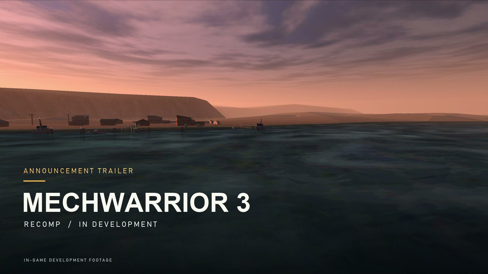
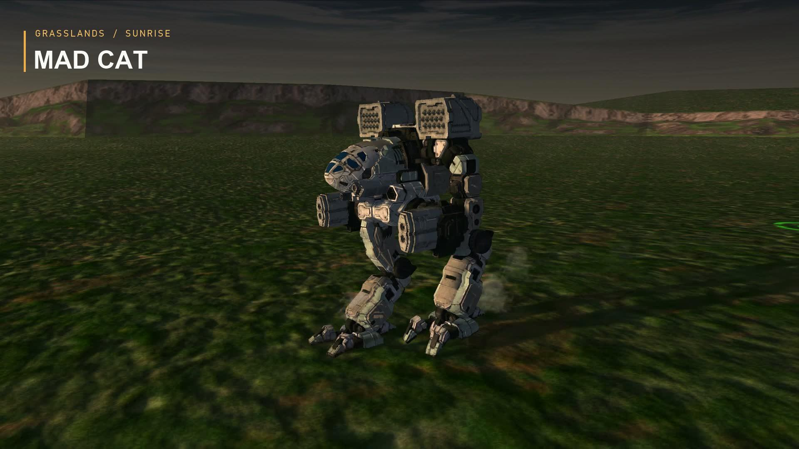
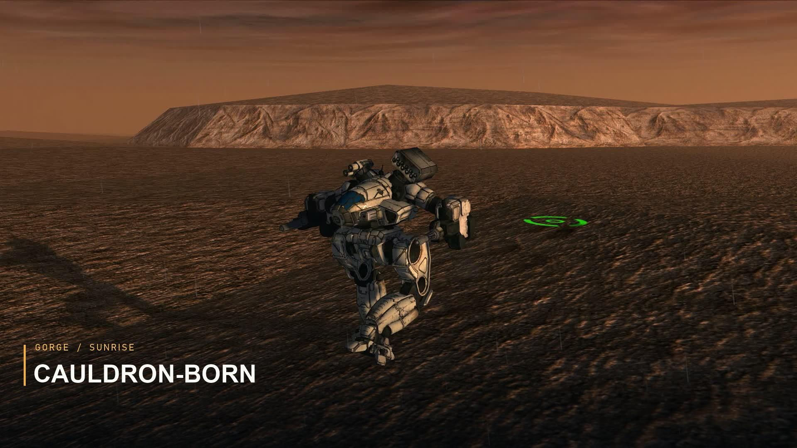
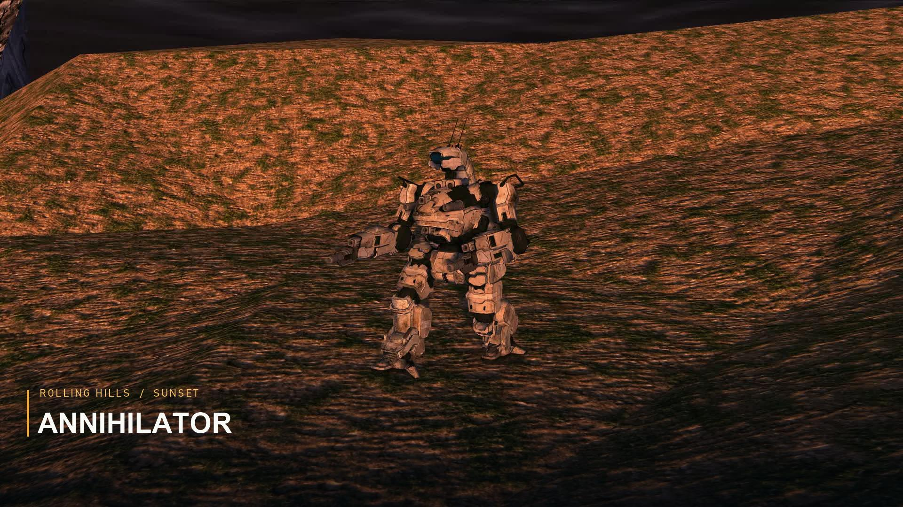
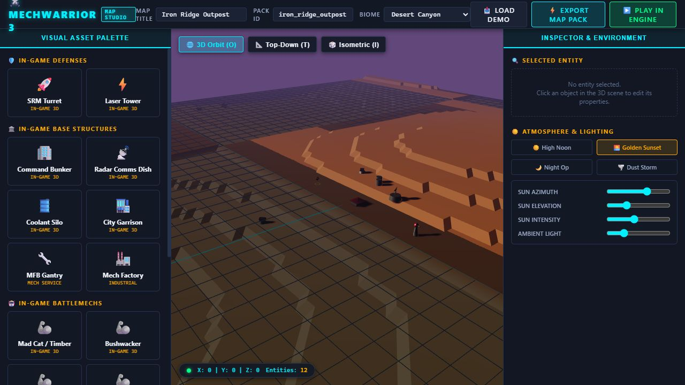

# Screenshots and development videos

## Announcement trailer

[MechWarrior 3 and Pirate's Moon Recompile/Remaster](https://www.youtube.com/watch?v=2olchoLkZro)
introduces the project through development footage. Native scene captures show
the enhanced visual profile, including optional replacement models, textures and
lighting. Filming-camera shots and edited sound are presentation choices, not a
performance benchmark or proof of complete gameplay fidelity. Original audio and
replacement assets are not downloadable repository content.

## Native enhanced-profile captures

Mad Cat, Grasslands at sunrise. Native development capture selected for the
October 19 announcement edit.

Cauldron-Born, Gorge at sunrise. Optional replacement visuals and detached camera.

Annihilator, Rolling Hills at sunset. This October 19 image predates subsequent
attachment/detail revisions and is retained as a dated trailer image.

## Mech evolution videos

| Video | Link |
| --- | --- |
| Bushwacker | [Watch](https://www.youtube.com/watch?v=eAOmooBIMNw) |
| Mad Cat | [Watch](https://www.youtube.com/watch?v=5Bh6mK8C1vw) |
| Cauldron-Born | [Watch](https://www.youtube.com/watch?v=33XduLfLjFo) |
| Orion | [Watch](https://www.youtube.com/watch?v=4Lcz2Ei1jTE) |
| Shadow Cat | [Watch](https://www.youtube.com/watch?v=GCHWXQs7zFE) |
| Thor | [Watch](https://www.youtube.com/watch?v=4pqve6w_QU8) |
| Vulture / Mad Dog | [Watch](https://www.youtube.com/watch?v=AwclBGEuybI) |
| Sunder | [Watch](https://www.youtube.com/watch?v=Tgsbq8uXMMA) |
| Puma | [Watch](https://www.youtube.com/watch?v=jGfYqkNbd3o) |
| Daishi | [Watch](https://www.youtube.com/watch?v=Zqbyj6aJzwQ) |

Titles and video IDs were read from the owner's
[CoreCritical channel](https://www.youtube.com/channel/UC0YGz5FEh7-ij1miUmXECiw/videos)
on October 21, 2026. Their appearance does not license downloadable model packs.

## Mod Tools prototype

An actual October 21 browser screenshot of the local Studio prototype. The
workspace contains locally extracted preview assets. This is an editing preview,
not native custom-map gameplay; the source download excludes those assets.

## Maintainer capture notes

The four JPEGs here are unmodified copies of the reviewed October 19 trailer
poster and shots 08, 18 and 23. Private source selection is recorded in ignored
`reports/announcement-trailer-20261019-r5/`; no source path or private Drive link
is needed to view this gallery. See the [dated edit notes](../announcement-trailer-revision-5-2026-10-19.md)
for capture and editing scope. Promotional images do not change the asset
distribution policy or grant rights to underlying game content.

Still needed for the release presentation: an ordinary cockpit/HUD shot, a
current GUI launcher shot and desktop editor shot. Native application capture
was unavailable in this session; the browser screenshot above is verified.
Capture the real
interfaces with personal paths and pilot names excluded. Show the editor's
prototype status; do not substitute launcher artwork for a screenshot of its UI.
Older pre-repair F9 captures can have invalid colors/doubled frames and must not
be used. No game assets, packs or video masters belong in this gallery.
